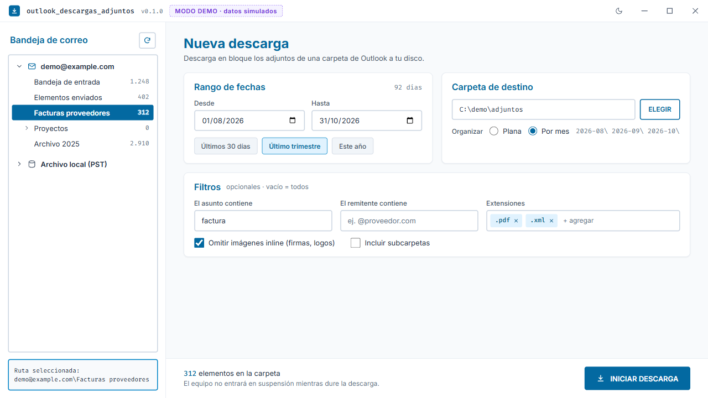
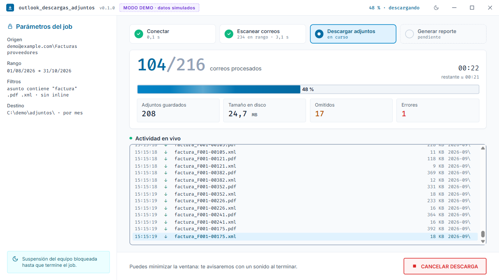
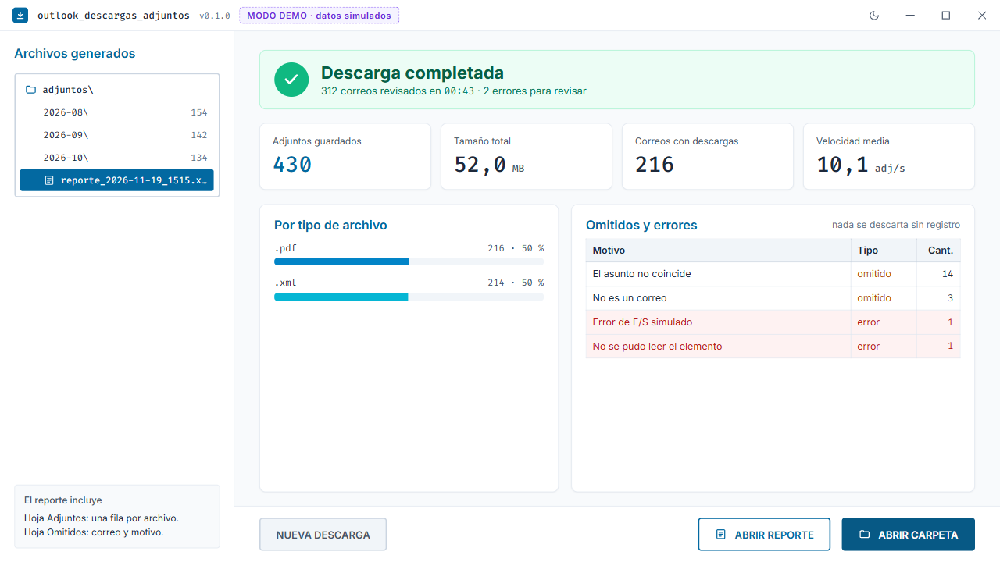
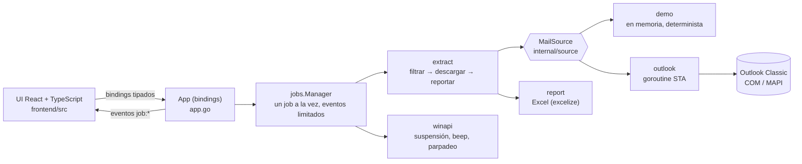
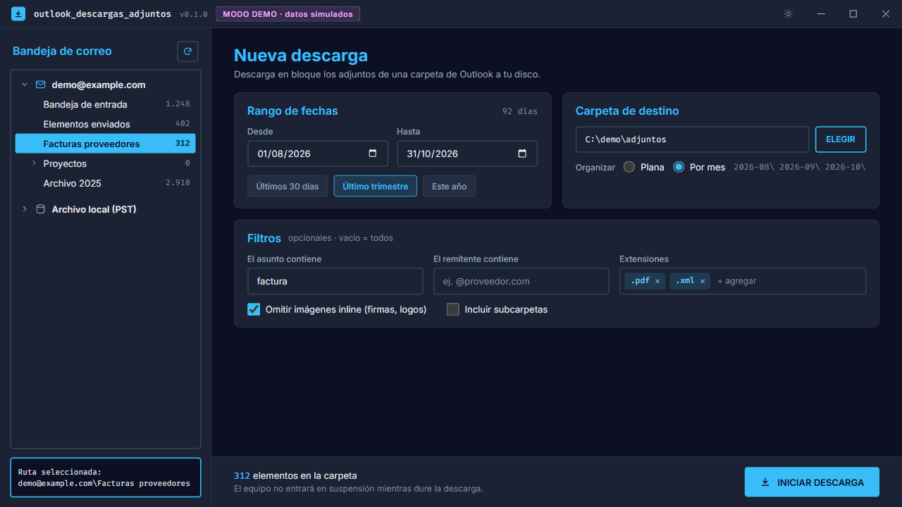
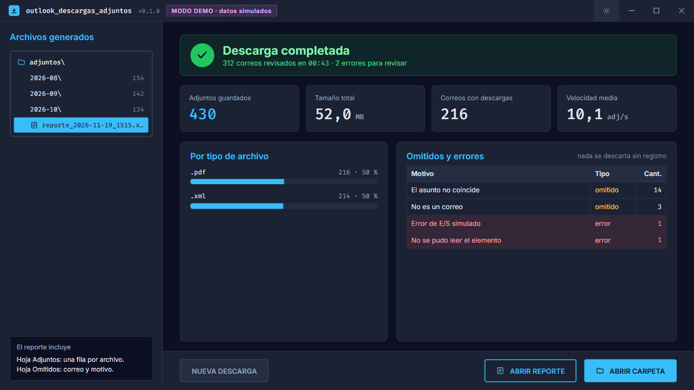

# outlook_descargas_adjuntos

App de escritorio para Windows que descarga en bloque los adjuntos de una carpeta de **Outlook Classic**,
con progreso en vivo, cancelación y un reporte Excel de lo que pasó con cada correo. Hecha con
**Go + Wails v2 + React (TypeScript)**.



## Qué hace

- Explora las cuentas y carpetas de Outlook en un árbol que carga las subcarpetas bajo demanda. Opcionalmente incluye las subcarpetas de la elegida.
- Filtra por rango de fechas (obligatorio) y, si quieres, por texto en el asunto, texto en el remitente y extensiones de adjunto (`pdf, xlsx, ...`).
- Ignora por defecto los adjuntos inline (imágenes de firma y logos).
- Guarda en una carpeta de destino, plana o por subcarpeta `YYYY-MM`. Los nombres repetidos se resuelven con el sufijo `_N`, sin sobrescribir nunca.
- Muestra el progreso por fase, un registro de actividad en pantalla, permite cancelar y termina con un resumen.
- Escribe un reporte Excel con una fila por adjunto y una hoja de correos omitidos y errores, cada uno con su motivo.
- Tema claro y oscuro, evita que el equipo se suspenda durante la descarga y avisa al terminar (sonido y parpadeo de la ventana).
- **Modo demo**: una fuente de correos simulada para usar la app sin Outlook.

| En curso | Resumen |
| --- | --- |
|  |  |

## Pruébalo sin Outlook

Requisitos: Windows 10 u 11 con WebView2 (viene con Windows 11 y con Edge).

Con Go 1.26+, Node 24 y el CLI de Wails v2.17.1:

```bash
go install github.com/wailsapp/wails/v2/cmd/wails@v2.17.1
wails dev -appargs "--demo"      # desarrollo con la fuente simulada
wails build -clean -trimpath     # binario en build/bin/
build/bin/outlook_descargas_adjuntos.exe --demo
```

El ejecutable no está firmado: SmartScreen puede pedir confirmación ("Más información" → "Ejecutar de todas formas").

Sin `--demo`, la app se conecta al Outlook Classic del equipo.

## Arquitectura



- `internal/domain` tiene los tipos puros y no importa nada externo.
- `extract` depende de la **interfaz** `MailSource`, nunca del adaptador de Outlook: toda la lógica se prueba con la fuente demo.
- La UI solo conoce el estado del job por los eventos (`job:progress`, `job:activity` y un terminal `job:done` | `job:error` | `job:cancelled`) o por `GetJobStatus`.

## Decisiones técnicas

**COM en un goroutine STA.** Todo el acceso a Outlook corre en un único goroutine fijado a su hilo del sistema
(`LockOSThread` + `CoInitializeEx` en modo apartment). El resto del programa le pasa funciones por un canal, así
ningún `IDispatch` cruza de hilo. Cada objeto COM se libera de forma determinista con helpers que hacen `Release`,
y el recorrido de una carpeta se entrega en streaming: los correos se leen en el STA y se procesan fuera de él.
Ver [ADR 0002](docs/adr/0002-com-en-goroutine-sta.md) y [internal/outlook/sta.go](internal/outlook/sta.go).

**Jobs con `context`, eventos limitados y un evento terminal siempre.** Los bindings vuelven en el acto con un
`jobID`; el job corre en su goroutine y se cancela con `context.Context`. El progreso y la actividad se agrupan
y se publican como mucho cada 100 ms, y todo job termina con exactamente un evento terminal, también al
cancelar. Ver [ADR 0003](docs/adr/0003-jobs-y-eventos.md) y [internal/jobs/manager.go](internal/jobs/manager.go).

**Fechas OLE como hora de reloj.** `ReceivedTime` llega como `VT_DATE` en hora local. go-ole lo etiqueta como UTC
y descarta los milisegundos, así que la conversión es propia: calcula el día en aritmética UTC y construye la
hora local con `time.Date`, lo que también es correcto en los días de cambio de horario. El rango se compara por
días completos. Ver [internal/outlook/convert.go](internal/outlook/convert.go).

**Fuente demo determinista.** La misma interfaz `MailSource` tiene una implementación en memoria con cuentas,
carpetas, cientos de correos ficticios, latencia simulada y errores a propósito. Sirve para los tests, para
desarrollar la UI y para grabar el video sin exponer un buzón real. Ver [ADR 0004](docs/adr/0004-fuente-demo.md).

**Nada se omite sin registro.** Un error en un correo nunca aborta el job: los items que no son correo, los
correos fuera de filtro y los adjuntos que fallan quedan en el reporte con su motivo. Si el job se cancela, se
escribe el reporte parcial. Ver [internal/extract/extract.go](internal/extract/extract.go).

La elección del stack está en el [ADR 0001](docs/adr/0001-go-wails.md).

## Pruebas

```bash
go test ./...                     # toda la lógica, con la fuente demo; no necesita Outlook
cd frontend && npm test           # lógica del frontend (Vitest, src/lib)
cd frontend && npm run build      # typecheck + build
go vet ./... && go vet -tags integration ./...
```

- `extract`, `report`, `jobs` y el saneamiento de nombres tienen tests de tabla con inyección de errores.
- El adaptador COM se prueba con objetos COM del sistema (`Scripting.Dictionary`) para verificar que no fuga referencias, y el STA se prueba con cancelación, paradas, panics y cierre.
- Contra Outlook real hay tests de integración (`//go:build windows && integration`) y un checklist manual en
  [docs/validacion-outlook.md](docs/validacion-outlook.md). Se corren solo en local:

  ```bash
  go test -tags integration ./internal/outlook/ -v
  go run ./cmd/spike-outlook -n 10000      # mide el recorrido COM; solo imprime conteos
  ```

## Rewrite desde Python

El proyecto reescribe una herramienta interna hecha en Python (PySide6 + pywin32). El rewrite es una descarga
genérica: no porta las reglas de negocio del original. Estos son los defectos técnicos del original que se
corrigieron:

| # | En el original | En el rewrite |
| --- | --- | --- |
| B4 | Los items que fallaban al leerse se saltaban sin registro | Cada item queda en el reporte, como omitido o error, con su motivo |
| B7 | Cancelar dejaba la UI bloqueada hasta reiniciar | Todo job emite un evento terminal; la UI se recupera al instante |
| B9 | La auditoría buscaba linealmente por `entry_id` (O(n²)) | Un registro por correo, añadido en orden (O(n)) |
| B10 | La auditoría vivía en memoria y se perdía si el proceso se caía | El reporte se escribe siempre, también al cancelar o si falla una carpeta (si el proceso muere, se pierde la ejecución en curso) |
| B11 | Acumulación de objetos COM: se degradaba tras miles de correos | `Release` determinista de cada `IDispatch`, verificado con conteo de referencias en los tests |
| B12 | Carpetas resueltas por nombre | `EntryID` + `StoreID`; la ruta legible es solo para la UI |
| B13 | Logs en el directorio de trabajo y config junto al `.exe` | Config en `%APPDATA%`, logs en `%LOCALAPPDATA%` |
| B14 | Dos mecanismos de cancelación distintos y una pausa que no existía | Un único modelo de job con `context` |
| B15 | La UI leía las estadísticas del worker sin sincronización | Las estadísticas viajan en el payload del evento |
| B16 | Una barra 0–100 % reutilizada para dos fases | Progreso por fase, indeterminado mientras se escanea |
| B17 | Descargaba las imágenes inline de las firmas | Filtra por `Attachment.Type` y detecta los inline |
| B18 | Nombres de archivo sin sanear y rutas de más de 260 caracteres | Saneamiento y recorte para que la ruta quede bajo `MAX_PATH` |
| B21 | El selector de carpetas llamaba a COM en el hilo de la UI | Las llamadas corren en el STA y la UI pide los hijos de forma asíncrona |

### Rendimiento

Las cifras del original frente al rewrite (tiempo y memoria sobre la misma carpeta) se publicarán tras la
validación local con Outlook real. Este README no publica números estimados.

## Limitaciones

- Solo Windows y solo **Outlook Classic** (COM/MAPI). No funciona con el nuevo Outlook.
- Procesa lo que está en la caché local (OST) del perfil.
- Según la configuración del equipo, leer la dirección del remitente puede disparar el aviso de seguridad de
  Outlook (Object Model Guard) si no hay un antivirus reconocido.
- Los adjuntos de los correos fuera del rango de fechas también se leen al escanear (para listar su nombre y
  tipo). Optimizarlo requiere cambiar la interfaz `MailSource` y se hará solo si el benchmark lo justifica.
- El ejecutable no está firmado: SmartScreen puede pedir confirmación.

## Licencia

MIT. Ver [LICENSE](LICENSE).

## Tema oscuro

| Configurar | Resumen |
| --- | --- |
|  |  |
